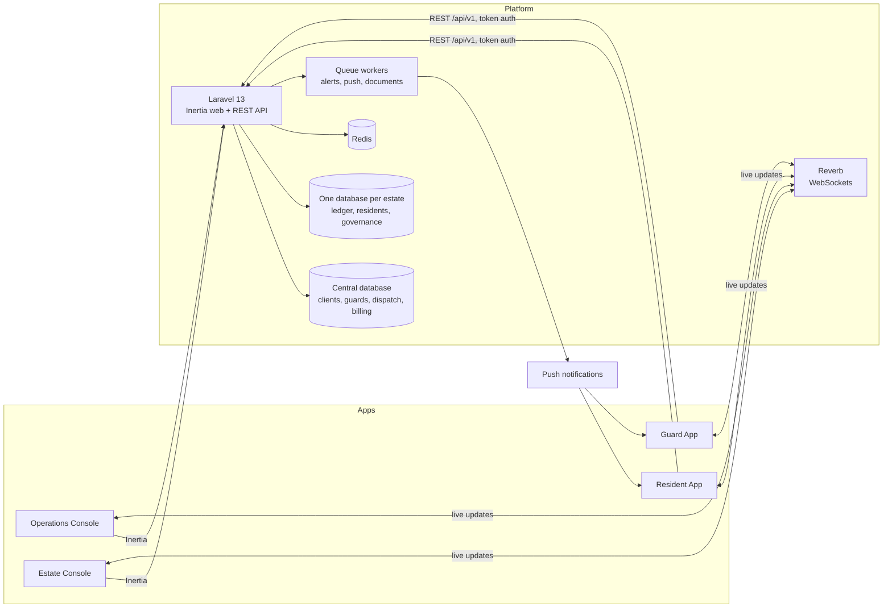

<div align="center">

# GeminiSecure

### Estate security and community management, in one platform

**A multi-tenant SaaS for gated communities and the security companies that protect them.**
Panic alerts, live guard tracking, dispatch and visitor control, alongside dues, accounting, payroll,
maintenance and governance, across two web consoles and two mobile apps.

[](https://laravel.com)
[](https://php.net)
[](https://vuejs.org)
[](https://reactnative.dev)
[](https://expo.dev)
[](https://mysql.com)
[](https://www.typescriptlang.org)
[](#status)

</div>

---

## Overview

Gated communities run on two things at once: **security** (who is at the gate, where the guards are, what happens when
someone presses panic) and **community administration** (dues, accounts, staff, repairs, meetings, elections). Most
estates juggle a radio, a paper gate log, spreadsheets and a messaging group for this. GeminiSecure replaces all of it
with one platform.

It is **multi-tenant SaaS**: a security company subscribes once, operates every estate it protects from one console,
and each estate's committee runs its own community from a console of its own. Every estate's data lives in **its own
database**, so one community can never see another's.

The platform is **in production in Jamaica**, built around Jamaican currency, payroll law, tax and time, and designed
so that each of those is a setting, not a rewrite, when it moves to a new country.

## Four products, one platform

| Product | Who uses it | What it is for |
| :--- | :--- | :--- |
| **Operations Console** | The security company's staff, across every estate | Dispatch, the live guard map, rosters and posts, workforce and payroll, client billing |
| **Estate Console** | One community's committee and management office | Residents and households, dues and ledger, accounting, maintenance, facilities, notices, meetings, elections |
| **Resident App** | A household inside one estate (Android) | Panic button, visitor passes, dues and payments, maintenance requests, incident reports, notices, voting |
| **Guard App** | An officer on shift (Android) | Clock in at the post, visitor verification at the gate, checkpoints, incidents, duress alerts, payslips |

## Features

### Security and emergency response
- **Panic and duress alerts** from residents and guards, delivered to the control room in seconds with the caller's
  live position, household contacts and the nearest guards on duty
- **Dispatcher's live map** of every officer on duty, with freshness states (Live, Last seen, No signal) and an automatic
  **No signal alert** when a guard's phone goes quiet
- **Live guard tracking during an open shift only**, on recorded consent; the server refuses any position that arrives
  outside a shift
- **Incident reporting** with photos and voice dictation, classified, assigned and closed with a full trail
- **Drill mode** for safe end-to-end rehearsal of the emergency path

### Gate and visitor control
- Residents issue **digital visitor passes** (one-off, recurring, time-windowed) and share them from the phone
- Guards **scan and verify** at the gate: valid, early, expired, already used, cancelled, wrong site, or no pass, each
  with its own outcome and log entry
- **Access restriction for arrears** that never applies to emergency services, medical vehicles or the resident
  themselves, and never shows a guard any amount owed

### Dues, billing and payments
- **Monthly charge schedules** with a preview before posting, mid-year rate changes and month reversals
- **Arrears ageing** (current, 30, 60, 90+ days), unit ledgers and statements, receipts
- **Payment plans** with instalments, household agreement and activation, and **dunning** reminders with editable
  templates
- Money stored as **integer minor units with an explicit currency**, so every figure reconciles to the cent

### Accounting
- **Double-entry general ledger**: chart of accounts, journals (posted entries are append-only; corrections are
  reversals), trial balance
- **Vendors and bills**, payments, **bank reconciliation**, budgets and budget versus actual
- Financial reports, each **exported exactly as shown on screen**

### Payroll and HR
- A **statutory payroll engine** with versioned rate tables, so a historical run never changes and a future rate can
  never be used early
- **Two-person approval**: whoever performed the final calculation cannot approve it
- Payslips with every deduction, its rate and base, year-to-date figures and employer contributions; statutory filings
  and a compliance calendar
- Guard payroll driven by **clocked shifts**, from the Guard App to the payslip on the guard's phone

### Facilities and maintenance
- **Maintenance requests** from the Resident App to the management office and a vendor, with every status change
  sent back to the household, who confirms the fix
- **Amenity bookings** with capacity, opening hours, fees, deposits, cancellation rules and approvals

### Governance
- **Notices** with audiences and read receipts
- **Meetings**: notice periods, agendas, quorum, recording consent, minutes, postponements
- **Elections with a secret ballot**: one vote per household, a ballot that cannot be changed once cast, and voter
  turnout kept in a separate table from ballot choices with **no way to link a vote to a voter**, not even for a
  database administrator

### Platform
- **Client onboarding** and plans, subscription billing, invoices and credit notes
- **Role-based access per console**, generated from one permission matrix: a module a role cannot use is absent, never
  greyed out
- A complete **audit log**, live updates on every screen, and push notifications to both apps

## Built for Jamaica

| Area | How it works today |
| :--- | :--- |
| Currency | Jamaican dollars (JMD), held as integer cents with an explicit currency code |
| Payroll law | NIS, NHT, Education Tax, PAYE (two bands above the threshold) and the employer's HEART contribution, from versioned statutory rate tables |
| Tax | GCT and corporate tax views in accounting |
| Time | Every time is stored in UTC and shown on the estate's own clock (`America/Jamaica`), by time zone name, never a fixed offset |
| Language | Written in plain English for committees, residents and guards |

## Ready for new countries

What is specific to a country is kept in one place each, so a new market is configuration plus one statutory module,
not a fork:

- **Money** already carries its currency on every amount; a second currency needs no schema change
- **Statutory payroll** reads dated rate tables; a new country is a new rate set and its rules
- **Time** is resolved by IANA time zone name per estate, so estates in different zones (and with daylight saving)
  work side by side
- **Tenancy** is one database per estate, so data can be hosted in the region a client's law requires
- On the roadmap: per-country tax and payroll modules, localised language packs, and the iOS apps

## Architecture



### Four guarantees, enforced by the database rather than by discipline

1. **Tenant isolation is physical.** Each estate has its own database and its own database credentials. A leak between
   two communities would be a connection error, not a forgotten `WHERE` clause.
2. **A guard never sees an amount owed.** The guard's API token carries only whether access is restricted; no
   endpoint a guard can reach returns a balance.
3. **A vote can never be linked to a voter.** Ballot choices and participation live in separate tables with no join key.
4. **Posted records are append-only.** Journals, gate events, approved pay runs, votes and audit entries cannot be
   updated or deleted: withheld at the grant level and refused again by triggers. A correction is a new record.

### Privacy by design
- **Biometrics never leave the phone**: the device answers yes or no; no template, image or score is sent or stored
- **Location is collected only when it is owed**: a guard during an open shift, a resident during an open panic
- Consent to tracking is **versioned and recorded**, and the screens never show more than the consent said

## Tech stack

| Layer | Technology |
| :--- | :--- |
| Server | Laravel 13, PHP 8.3+, `stancl/tenancy` (multi-database), Sanctum, Reverb, Redis, queue workers, DomPDF, `brick/money` |
| Web consoles | Inertia, Vue 3 (Composition API), Vite, hand-written CSS on a token-based design system |
| Mobile | Expo SDK 57, React Native 0.86, React 19, TypeScript (strict), Expo Router, RTK Query, NativeWind |
| Data | MySQL 8.4: one central database plus one database per estate |
| Quality | Pest (thousands of automated tests), Larastan, Pint, Jest, purpose-built build gates on both sides |

## Repository structure

```
server/                     Laravel application: both web consoles and the REST API
  app/Services/             every business rule, shared by the consoles and the API
  app/Http/Controllers/     Estate/, Gemini/ (Operations Console), Api/V1/ (the apps)
  database/migrations/      central schema; migrations/tenant/ is each estate's schema
  resources/js/             Vue pages, components and layouts
  routes/                   web, tenant (Estate Console), api (/api/v1), live (WebSockets)
  tests/                    Feature and Unit tests (Pest)
  MOBILE_HANDOFF.md         the REST API the two apps consume

mobile/                     npm workspace with both Android apps
  apps/resident/            the Resident App
  apps/guard/               the Guard App
  packages/core/            shared API client, auth, offline queue, design system, safety features
  tools/                    build gates, fidelity and device tooling, release signing checks
  store/                    store listing material
```

## Getting started

### Server

Requirements: PHP 8.3+, Composer 2, Node 20+, MySQL 8.0+, Redis.

```bash
cd server
composer install && npm install
cp .env.example .env && php artisan key:generate

mysql -u root < database/sql/00_mysql_setup.sql     # the owner and application database roles
php artisan migrate --database=mysql_owner
php artisan db:seed --class=RbacMatrixSeeder
php artisan grants:append-only

php artisan estate:provision demoestate "Demo Estate" --status=active
php artisan gate:isolation                          # must print GATE PASSED
npm run dev && php artisan serve
```

### Mobile

```bash
cd mobile
npm install
npm run typecheck && npm test        # TypeScript and the Jest suites for both apps and the shared package
npm run gate:guard-no-money && npm run gate:one-clock && npm run gate:location   # a few of the build gates
```

Point each app at a running server with `EXPO_PUBLIC_API_URL` (see `apps/*/.env.example`). Push notifications need
your own Firebase `google-services.json` in each app folder.

## Quality

- **Thousands of automated tests** across the server (Pest) and both apps (Jest), run against MySQL, not SQLite
- **Static analysis** with Larastan and consistent style with Pint
- **Gates that fail the build** rather than file a report: tenant isolation at the database, ledger balance (debits
  equal credits, sub-ledgers tie to control accounts), role-based navigation, "nothing looks interactive and does
  nothing", and design tokens, plus on mobile: one clock, location discipline, no money in the Guard App, store
  compliance and accessibility
- **Query budgets** keep every page within a fixed number of database queries at 2,000 units

## Status

In production since October 2026 with a pilot estate of nearly 2,000 units; both Android apps are built and signed.

## License

Copyright © 2026. All rights reserved. This repository is published for reference; no licence is granted to copy,
modify, distribute or use any part of it without written permission.
